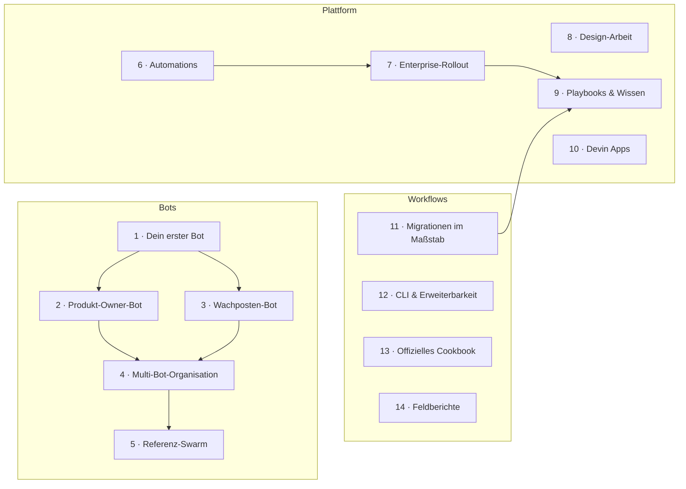

<picture>
  <source media="(prefers-color-scheme: dark)" srcset="assets/cover-dark.svg">
  
</picture>

 

Kuratiert von [@darega0mae](https://x.com/darega0mae) · Schwester-Register: [built-with-devin](https://github.com/Till3005/built-with-devin) · [Verbessere einen Guide](CONTRIBUTING.md)

**14** Guides · **3** Lernpfade · jedes Muster aus einem namentlich dokumentierten Deployment abgeleitet

[English](README.md) · [简体中文](README.zh.md) · [日本語](README.ja.md) · [Português](README.pt.md) · [Español](README.es.md) · Deutsch

> *Inoffizielles Community-Projekt — nicht mit Cognition AI verbunden, nicht von Cognition AI unterstützt oder gesponsert. „Devin" ist eine Marke von Cognition AI. Marken-Assets werden gemäß dem offiziellen Kit unter [devin.ai/brand](https://devin.ai/brand) verwendet. Offizielle Doku: [docs.devin.ai](https://docs.devin.ai).*

**Build with Devin** ist eine Tutorial-Sammlung: Jeder Guide nimmt ein *reales, dokumentiertes* Devin-Deployment — von Cognitions eigener Launch-Flotte bis zu veröffentlichten Kundenfällen — und zerlegt es in reproduzierbare Schritte auf deinem eigenen Account. Keine hypothetischen Demos; hinter jedem Muster steht ein namentliches Deployment mit publizierten Zahlen.

**Zusammen nutzen mit [built-with-devin](https://github.com/Till3005/built-with-devin)** — dem Schwester-Register für alles, was Community und Cognition bereits ausgeliefert haben. Das Register beantwortet *was existiert*; dieses Repo beantwortet *wie man es baut*.

## Guides

### Devin Bots

| # | Guide | Du baust | Grundlage | Niveau |
| --- | --- | --- | --- | --- |
| 1 | [Dein erster Bot](guides/bots-101-first-bot.md) | Einen Bot, der ein Ergebnis besitzt — Chat, Sessions, Needs-you, Gedächtnis, Oberflächen | [Offizielle Doku](https://docs.devin.ai/work-with-devin/bots) | Starte hier |
| 2 | [Produkt-Owner-Bot](guides/bots-201-product-owner.md) | Einen Bot, der eine ganze App-Fläche als sein Produkt betreibt | Android Bot — 44 Tage, 1.134 PRs | Mittel |
| 3 | [Geplanter Wachposten-Bot](guides/bots-202-scheduled-sentinel.md) | Einen Cron-Bot, der eine Prüfung besitzt und Regressionen behebt | Layout Bot — 159 PRs/3 Wo. | Mittel |
| 4 | [Multi-Bot-Organisation](guides/bots-203-multi-bot-org.md) | Eine Bot-Hierarchie mit Grants und Roll-up-Reporting | SuperJennyStack — ~20 Bots, 1.900 PRs/Wo. | Fortgeschritten |
| 5 | [Referenz-verankerter Swarm](guides/bots-204-reference-grounded-swarm.md) | Einen dirigierten Swarm, der ein verifiziertes System schreibt | Harvey „Phil" — ~30 Agenten, 1M+ Zeilen | Fortgeschritten |

### Plattform

| # | Guide | Du baust | Grundlage | Niveau |
| --- | --- | --- | --- | --- |
| 6 | [Event-gesteuerte Automations](guides/automations-101-event-driven.md) | Sessions, ausgelöst durch Slack, GitHub, Linear, Cron, Webhooks | [Automations-Docs](https://docs.devin.ai/product-guides/automations) | Starte hier |
| 7 | [Enterprise-Rollout-Muster](guides/enterprise-playbook.md) | Die sechs Deployment-Formen hinter den größten Ergebnissen | Nubank, Gumroad, EBANX, Modal, Airbyte… | Mittel |
| 8 | [Design- & Visual-Arbeit](guides/design-with-devin.md) | Art Direction einer Produktions-UI über den Devin-Chat | Spraycash-Landingpage-Report | Mittel |
| 9 | [Playbooks & Wissen](guides/playbooks-and-knowledge.md) | Org-Konventionen kodifizieren, damit jede Session sie erbt | Die Schicht hinter jedem Enterprise-Ergebnis | Mittel |
| 10 | [Devin Apps](guides/devin-apps.md) | Live-Interne-Tools und Dashboards aus Devins eigener Maschine | [Devin Apps Launch](https://devin.ai/blog/devin-apps) | Starte hier |

### Workflows

| # | Guide | Du baust | Grundlage | Niveau |
| --- | --- | --- | --- | --- |
| 11 | [Migrationen im Maßstab](guides/migrations-at-scale.md) | Eine Migration als hunderte kleine verifizierte PRs | Offizieller Playbook + Nubank | Mittel |
| 12 | [Devin CLI & Erweiterbarkeit](guides/devin-cli.md) | Der lokale Agent: Cloud-Handoff, Skills, Plugins, Hooks | [CLI-Docs](https://docs.devin.ai/cli/index.md) | Mittel |
| 13 | [Offizielles Use-Case-Cookbook](guides/official-cookbook.md) | 40+ dokumentierte Rezepte — Hygiene-Loops, Incidents, Qualität | [Use-Case-Galerie](https://docs.devin.ai/use-cases/gallery/index.md) | Starte hier |
| 14 | [Community-Feldberichte](guides/community-field-reports.md) | Was echte Teams gelernt haben — Erfolge, Misserfolge, Deployments mit Zahlen | 15+ veröffentlichte Praxisberichte | Starte hier |

---

## So nutzt du dieses Repo

- **Neu bei Bots?** Guide 1, dann 2 oder 3 — die sind am reproduzierbarsten.
- **Schnelle Erfolge?** Die geplanten Hygiene-Rezepte aus Guide 13 sind der billigste Einstieg.
- **Team-Leitung?** Guides 4, 7 und 9 sind für dich geschrieben.
- Jeder Guide endet mit **Sources** — dem Launch-Post, Docs-Seite oder Report, aus dem das Muster destilliert wurde — und **Verify it**, der Prüfung, die bestätigt, dass die Reproduktion funktioniert hat.

---

## Konventionen

- Jeder Guide ist in sich abgeschlossen: Ziel → Voraussetzungen → der Aufbau, Schritt für Schritt → Betrieb → Fallstricke.
- Prompts werden wörtlich zitiert, wenn die Quelle sie veröffentlicht hat; sonst sind sie Rekonstruktionen und als solche markiert.
- Die Zahlen eines Guides stammen aus dem zitierten Deployment, nicht aus unseren Annahmen.

## Mitwirken

Ein besseres Rezept gefunden oder eines reproduziert mit eigenen Zahlen? Siehe [CONTRIBUTING.md](CONTRIBUTING.md).

## Lizenz

[CC0-1.0](LICENSE) — der Public Domain gewidmet.
