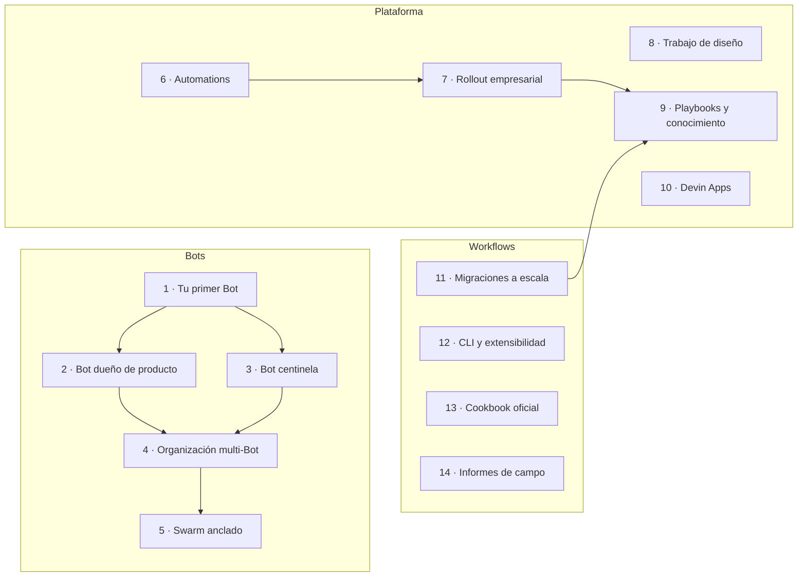

<picture>
  <source media="(prefers-color-scheme: dark)" srcset="assets/cover-dark.svg">
  
</picture>

 

Curado por [@darega0mae](https://x.com/darega0mae) · Registro hermano: [built-with-devin](https://github.com/Till3005/built-with-devin) · [Mejora una guía](CONTRIBUTING.md)

**14** guías · **3** rutas · cada patrón derivado de un despliegue nombrado y documentado

[English](README.md) · [简体中文](README.zh.md) · [日本語](README.ja.md) · [Português](README.pt.md) · Español · [Deutsch](README.de.md)

> *Proyecto comunitario no oficial — sin afiliación, respaldo ni patrocinio de Cognition AI. "Devin" es marca registrada de Cognition AI. Los recursos de marca se usan según el kit oficial en [devin.ai/brand](https://devin.ai/brand). Documentación oficial: [docs.devin.ai](https://docs.devin.ai).*

**Build with Devin** es una colección de tutoriales: cada guía toma un despliegue *real y documentado* de Devin — desde la flota de lanzamiento de la propia Cognition hasta casos de clientes publicados — y lo descompone en pasos reproducibles en tu propia cuenta. Sin demos hipotéticas; cada patrón tiene detrás un despliegue nombrado y cifras publicadas.

**Úsalo junto con [built-with-devin](https://github.com/Till3005/built-with-devin)** — el registro hermano de todo lo que la comunidad y Cognition han entregado. El registro responde *qué existe*; este repo responde *cómo construirlo*.

## Guías

### Devin Bots

| # | Guía | Construirás | Basada en | Nivel |
| --- | --- | --- | --- | --- |
| 1 | [Tu primer Bot](guides/bots-101-first-bot.md) | Un Bot dueño de un resultado — chat, sesiones, Needs-you, memoria, superficies | [Documentación oficial](https://docs.devin.ai/work-with-devin/bots) | Empieza aquí |
| 2 | [Bot dueño de producto](guides/bots-201-product-owner.md) | Un Bot que gestiona como producto una superficie entera de app | Android Bot — 44 días, 1.134 PRs | Intermedio |
| 3 | [Bot centinela programado](guides/bots-202-scheduled-sentinel.md) | Un Bot por cron que vigila una comprobación y corrige regresiones | Layout Bot — 159 PRs/3 sem. | Intermedio |
| 4 | [Organización multi-Bot](guides/bots-203-multi-bot-org.md) | Una jerarquía de Bots con grants e informes consolidados | SuperJennyStack — ~20 Bots, 1.900 PRs/sem | Avanzado |
| 5 | [Swarm anclado a referencia](guides/bots-204-reference-grounded-swarm.md) | Un swarm dirigido escribiendo un sistema verificado | Harvey "Phil" — ~30 agentes, 1M+ líneas | Avanzado |

### Plataforma

| # | Guía | Construirás | Basada en | Nivel |
| --- | --- | --- | --- | --- |
| 6 | [Automations dirigidas por eventos](guides/automations-101-event-driven.md) | Sesiones disparadas por Slack, GitHub, Linear, cron, webhooks | [Docs de Automations](https://docs.devin.ai/product-guides/automations) | Empieza aquí |
| 7 | [Patrones de rollout empresarial](guides/enterprise-playbook.md) | Las seis formas de despliegue detrás de los mayores resultados | Nubank, Gumroad, EBANX, Modal, Airbyte… | Intermedio |
| 8 | [Trabajo de diseño y visual](guides/design-with-devin.md) | Dirección de arte de UI de producción vía el chat de Devin | Relato de la landing de Spraycash | Intermedio |
| 9 | [Playbooks y conocimiento](guides/playbooks-and-knowledge.md) | Codificar las convenciones de la org para que toda sesión las herede | La capa detrás de todo resultado empresarial | Intermedio |
| 10 | [Devin Apps](guides/devin-apps.md) | Herramientas internas y dashboards en vivo servidos desde la máquina de Devin | [Lanzamiento de Devin Apps](https://devin.ai/blog/devin-apps) | Empieza aquí |

### Workflows

| # | Guía | Construirás | Basada en | Nivel |
| --- | --- | --- | --- | --- |
| 11 | [Migraciones a escala](guides/migrations-at-scale.md) | Una migración como cientos de PRs pequeños y verificados | Playbook oficial + Nubank | Intermedio |
| 12 | [Devin CLI y extensibilidad](guides/devin-cli.md) | El agente local: handoff a la nube, skills, plugins, hooks | [Docs del CLI](https://docs.devin.ai/cli/index.md) | Intermedio |
| 13 | [Cookbook oficial de casos de uso](guides/official-cookbook.md) | 40+ recetas documentadas — bucles de higiene, incidentes, calidad | [Galería de casos de uso](https://docs.devin.ai/use-cases/gallery/index.md) | Empieza aquí |
| 14 | [Informes de campo de la comunidad](guides/community-field-reports.md) | Lo que equipos reales aprendieron — aciertos, fallos y despliegues nombrados con cifras | 15+ relatos hands-on publicados | Empieza aquí |

<a href="#readme">back to top</a>

---

## Cómo usar este repositorio

- **¿Nuevo en Bots?** Haz la guía 1 y luego elige 2 o 3 — son las más reproducibles.
- **¿Quieres victorias rápidas?** Las recetas de higiene programada de la guía 13 son el despliegue inicial más barato.
- **¿Diriges un equipo?** Las guías 4, 7 y 9 están escritas para ti.
- Cada guía termina con **Sources** — el post de lanzamiento, página de docs o relato del que se destiló el patrón — y **Verify it**, la comprobación que confirma que la reproducción funcionó.

<a href="#readme">back to top</a>

---

## Convenciones

- Cada guía es autocontenida: objetivo → prerrequisitos → la construcción, paso a paso → operar el resultado → trampas.
- Los prompts se citan literalmente cuando la fuente los publicó; en caso contrario son reconstrucciones, marcadas como tales.
- Las cifras de una guía provienen del despliegue citado, no de nuestras suposiciones.

## Contribuir

¿Encontraste una receta mejor, o reprodujiste una y tienes cifras? Ver [CONTRIBUTING.md](CONTRIBUTING.md).

## Licencia

[CC0-1.0](LICENSE) — dedicado al dominio público.
