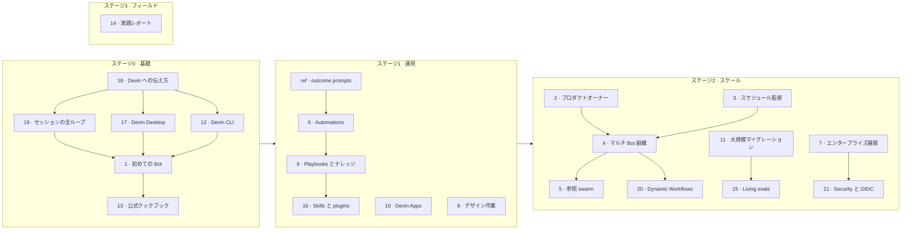

<picture>
  <source media="(prefers-color-scheme: dark)" srcset="assets/cover-dark.svg">
  
</picture>

 

Curated by [@darega0mae](https://x.com/darega0mae) · 姉妹レジストリ：[built-with-devin](https://github.com/Till3005/built-with-devin) · [ガイドを改善](CONTRIBUTING.md) · [サイトで読む](https://till3005.github.io/built-with-devin/guides/ja/index.html)

**22** ガイド · **4** ステージ · すべてのパターンは実名・実証済みの導入から逆算

[English](README.md) · [简体中文](README.zh.md) · 日本語 · [Português](README.pt.md)

> *非公式コミュニティプロジェクト —— Cognition AI との提携・承認・後援はありません。"Devin" は Cognition AI の商標です。ブランド素材は公式キット [devin.ai/brand](https://devin.ai/brand) に基づき使用。公式ドキュメント：[docs.devin.ai](https://docs.devin.ai)。*

**Build with Devin** はチュートリアル集です。各ガイドは、Cognition のローンチフリートから公開顧客事例まで、*実証済みの実在* Devin 導入を取り上げ、あなた自身のアカウントで再現できるステップに逆算しています。仮想デモはありません。すべてのパターンは、実名の導入と公開された数字に裏付けられています。

**姉妹リポジトリ [built-with-devin](https://github.com/Till3005/built-with-devin) と併用** —— コミュニティと Cognition が出荷したすべてのレジストリ。レジストリは*何があるか*を、本リポジトリは*どう作るか*を答えます。

## ガイド

### ステージ0 · 基礎

*ゼロから出荷されるタスクへ。全員ここから——2つの接続面、プロンプトの教義、最初の「所有」、公式レシピ集。*

| # | ガイド | 作るもの | ベース | レベル |
| --- | --- | --- | --- | --- |
| 18 | [Devin への伝え方：プロンプトの教義](guides/ja/talking-to-devin.md) | Devin が読み違えないブリーフ——say-how、チェック可能な成功、80% ルール | [Coding Agents 101](https://devin.ai/agents101) + [公式プロンプトドキュメント](https://docs.devin.ai/essential-guidelines/instructing-devin-effectively) | ここから |
| 19 | [セッションの全ループ](guides/ja/the-session-loop.md) | 理解 → 委任 → レビュー → 学習：DeepWiki、Ask Devin、Devin Review、Session Insights + ACU メーター | [Devin University](https://learndevin.com) + 公式プロダクトドキュメント | ここから |
| 17 | [Devin Desktop](guides/ja/devin-desktop.md) | エージェントネイティブなエディタ：Command Center、永続ローカルセッション、Bots——1つのウィンドウ | [Desktop changelog](https://docs.devin.ai/desktop/changelog) | ここから |
| 12 | [Devin CLI と拡張性](guides/ja/devin-cli.md) | ローカルエージェント：daemon セッション、クラウドハンドオフ、skills、hooks | [CLI ドキュメント](https://docs.devin.ai/cli/index.md) | 中級 |
| 1 | [初めての Bot](guides/ja/bots-101-first-bot.md) | 成果に責任を持つ Bot —— chat、セッション、Needs-you、メモリ、接続面 | [公式ドキュメント](https://docs.devin.ai/work-with-devin/bots) + ローンチ記事 | ここから |
| 13 | [公式ユースケースクックブック](guides/ja/official-cookbook.md) | 40 以上の文書化レシピ —— 衛生ループ、インシデント、品質 | [ユースケースギャラリー](https://docs.devin.ai/use-cases/gallery/index.md) | ここから |

### ステージ1 · 運用

*日常ループを委任する：標準を知る Bot、イベントで発火するセッション、一度エンコードすれば継承される規約、ライブ提供されるツール。*

| # | ガイド | 作るもの | ベース | レベル |
| --- | --- | --- | --- | --- |
| — | [Bot outcome prompt 解剖](guides/ja/bot-outcome-prompts.md) | タスクではなく所有権を割り当てる outcome prompt —— 実物をリバースエンジニアリング | Android Bot prompt + 全 16 マーケットプレーステンプレート | リファレンス |
| 6 | [イベント駆動 automations](guides/ja/automations-101-event-driven.md) | Slack、GitHub、Linear、cron、webhook で発火するセッション | [Automations ドキュメント](https://docs.devin.ai/product-guides/automations) | ここから |
| 9 | [Playbooks とナレッジ](guides/ja/playbooks-and-knowledge.md) | 組織の規約をエンコードし全セッションに継承させる | すべてのエンタープライズ成果の背後にある層 | 中級 |
| 16 | [Skills と plugins](guides/ja/skills-and-plugins.md) | playbook の次の層——SKILL.md 契約、発見機構、plugin パッケージング | [Skills ドキュメント](https://docs.devin.ai/product-guides/skills) | 中級 |
| 10 | [Devin Apps](guides/ja/devin-apps.md) | Devin のマシンから提供されるライブ内部ツールとダッシュボード | [Devin Apps ローンチ](https://devin.ai/blog/devin-apps) | ここから |
| 8 | [デザイン・ビジュアル作業](guides/ja/design-with-devin.md) | Devin チャットを通じた本番 UI のアートディレクション | Spraycash ランディングページ実践記 | 中級 |

### ステージ2 · スケール

*1つの Bot から組織へ：4つの実名導入アーキタイプ、そして重機——移行、評価、エンタープライズ展開。*

| # | ガイド | 作るもの | ベース | レベル |
| --- | --- | --- | --- | --- |
| 2 | [プロダクトオーナー Bot](guides/ja/bots-201-product-owner.md) | アプリ全体をプロダクト管理する Bot | Android Bot —— 44 日、1,134 PR | 中級 |
| 3 | [スケジュール監視 Bot](guides/ja/bots-202-scheduled-sentinel.md) | cron でチェックを監視し回帰を自ら修正する Bot | Layout Bot —— 3 週間で 159 PR | 中級 |
| 4 | [マルチ Bot 組織](guides/ja/bots-203-multi-bot-org.md) | grants とロールアップ報告を持つ Bot 階層 | SuperJennyStack —— ~20 Bot、週 1,900 PR | 上級 |
| 5 | [参照グラウンデッド swarm](guides/ja/bots-204-reference-grounded-swarm.md) | 検証済みシステムを書く指揮された swarm | Harvey "Phil" —— ~30 エージェント、100 万行超 | 上級 |
| 11 | [大規模マイグレーション](guides/ja/migrations-at-scale.md) | 数百の小さな検証済み PR としてのマイグレーション | 公式 playbook + Nubank | 中級 |
| 15 | [本番トレースからの Living evals](guides/ja/living-evals.md) | 自己増殖する eval スイート：Devin がシステムの完全コピーで本番障害を再生 | Rox —— 実使用量カバレッジ 72%（手書き 43–57%） | 上級 |
| 7 | [エンタープライズ展開パターン](guides/ja/enterprise-playbook.md) | 最大の顧客成果を生んだ 6 つの導入形態 | Nubank、Gumroad、EBANX、Modal、Airbyte…… | 中級 |
| 20 | [Dynamic Workflows](guides/ja/dynamic-workflows.md) | 構造化ハンドオフと再開可能な run を持つ決定的マルチ agent オーケストレーション | [Dynamic Workflows 公式ドキュメント](https://docs.devin.ai/work-with-devin/dynamic-workflows) | 上級 |
| 21 | [Security Profiles と Cloud OIDC](guides/ja/security-profiles-cloud-oidc.md) | 最小権限 session 境界 + 長期キーなしのクラウド認証 | [Security Profiles](https://docs.devin.ai/product-guides/security-profiles) + [Cloud OIDC](https://docs.devin.ai/product-guides/oidc) | 上級/管理者 |

### ステージ3 · フィールド

*実チームが本当に学んだこと——成功、失敗、公開された数字。*

| # | ガイド | 作るもの | ベース | レベル |
| --- | --- | --- | --- | --- |
| 14 | [コミュニティ実践レポート](guides/ja/community-field-reports.md) | 実チームが学んだこと —— 成功、失敗、数字つきの実名導入 | 15 以上の公開実践記 | ここから |

<a href="#readme">back to top</a>

---

## このリポジトリの使い方

初回はステージ順に。以降は自由にジャンプ。

- **ソロ開発者・初めて：** 18 → 17（ターミナル派なら 12）→ 1 → 13。1週間の分量。
- **すぐ成果が欲しい：** ガイド 13 のスケジュール衛生レシピが最も安い最初の導入。
- **チームリード：** 基礎に 6、9、16 を追加——ループ、規約、再利用レイヤー。
- **組織を率いている：** ステージ2 全部 → 7 → 14（他チームが実際にぶつかったこと）。
- 各ガイドの末尾には **Sources**（公式ドキュメント＋パターンの蒸留元となったコミュニティ/フィールド記事の両方）と **Verify it**（再現成功のチェック）があります。

<a href="#readme">back to top</a>

---

## 規約

- 各ガイドは自己完結：目標 → 前提条件 → ステップバイステップの構築 → 結果の運用 → 落とし穴。
- プロンプトは出典が公開している場合は逐語引用。それ以外は再構成として明記。
- ガイド内の数字は引用した導入のもの。私たちの推測ではありません。

## コントリビュート

より良いレシピを見つけた、または再現して数字が取れた？[CONTRIBUTING.md](CONTRIBUTING.md) へ。

## ライセンス

[CC0-1.0](LICENSE) —— パブリックドメインに捧げます。
