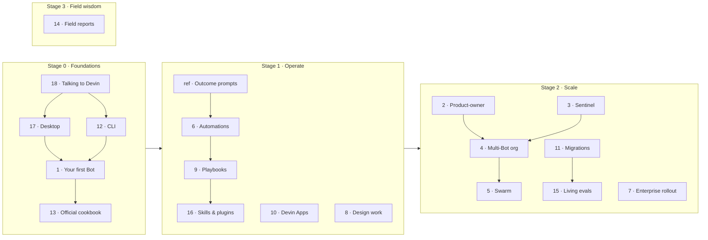

<picture>
  <source media="(prefers-color-scheme: dark)" srcset="assets/cover-dark.png">
  
</picture>

 

Curated by [@darega0mae](https://x.com/darega0mae) · Sister registry: [built-with-devin](https://github.com/Till3005/built-with-devin) · [Improve a guide](CONTRIBUTING.md)

**19** guides · **4** stages · every pattern reverse-engineered from a named, documented deployment

English · [简体中文](README.zh.md) · [日本語](README.ja.md) · [Português](README.pt.md)

> *Unofficial community project — not affiliated with, endorsed by, or sponsored by Cognition AI. "Devin" is a trademark of Cognition AI. Brand assets are used under the official kit at [devin.ai/brand](https://devin.ai/brand) — "ready for whatever you're making." Official docs: [docs.devin.ai](https://docs.devin.ai).*

**Build with Devin** is a tutorial collection: every guide takes a *documented, real-world* Devin deployment — from Cognition's own launch fleet to published customer cases — and reverse-engineers it into steps you can reproduce on your own account. No hypothetical demos; every pattern here is backed by a named deployment with reported numbers.

**Pair it with [built-with-devin](https://github.com/Till3005/built-with-devin)** — the companion registry of everything the community and Cognition have shipped. Registry answers *what exists*; this repo answers *how to build it*.

## Contents

- [Stage 0 — Foundations](#stage-0--foundations) — talking to Devin, the surfaces, your first Bot, the cookbook
- [Stage 1 — Operate](#stage-1--operate) — outcome prompts, automations, playbooks, skills, Apps, design
- [Stage 2 — Scale](#stage-2--scale) — one Bot to an org, migrations, evals, enterprise rollout
- [Stage 3 — Field wisdom](#stage-3--field-wisdom) — what real teams learned
- [How to use this repo](#how-to-use-this-repo) · [Conventions](#conventions) · [Contributing](#contributing)

## Guides

### Stage 0 · Foundations

*From zero to a task that ships. Everyone starts here — these four guides and one reference teach the two surfaces, the prompting doctrine, and the first ownership.*

| # | Guide | You'll build | Based on | Level |
| --- | --- | --- | --- | --- |
| 18 | [Talking to Devin](guides/talking-to-devin.md) | Briefs Devin can't misread — say-how, checkable success, the 80% rule | [Coding Agents 101](https://devin.ai/agents101) + [official prompting docs](https://docs.devin.ai/essential-guidelines/instructing-devin-effectively) | Start here |
| 17 | [Devin Desktop](guides/devin-desktop.md) | The agent-native editor: Command Center, durable local sessions, Bots — one window | [Desktop changelog](https://docs.devin.ai/desktop/changelog) | Start here |
| 12 | [Devin CLI & extensibility](guides/devin-cli.md) | The local agent: daemon sessions, cloud handoff, skills, hooks | [CLI docs](https://docs.devin.ai/cli/index.md) | Intermediate |
| 1 | [Your first Bot](guides/bots-101-first-bot.md) | A Bot that owns an outcome — chat, sessions, Needs-you, memory, surfaces | [Official docs](https://docs.devin.ai/work-with-devin/bots) + launch post | Start here |
| 13 | [Official use-case cookbook](guides/official-cookbook.md) | 40+ documented recipes — hygiene loops, incidents, quality | [Use-case gallery](https://docs.devin.ai/use-cases/gallery/index.md) | Start here |

### Stage 1 · Operate

*The daily loop delegated: a Bot that knows the standard, sessions that fire on events, conventions encoded once, tools served live.*

| # | Guide | You'll build | Based on | Level |
| --- | --- | --- | --- | --- |
| — | [Bot outcome prompts, dissected](guides/bot-outcome-prompts.md) | Outcome prompts that assign ownership, not tasks — the real ones, reverse-engineered | Android Bot prompt + all 16 marketplace templates | Reference |
| 6 | [Event-driven automations](guides/automations-101-event-driven.md) | Sessions that fire on Slack, GitHub, Linear, cron, webhooks | [Automations docs](https://docs.devin.ai/product-guides/automations) | Start here |
| 9 | [Playbooks & knowledge](guides/playbooks-and-knowledge.md) | Encoding org conventions so every session inherits them | The layer behind every enterprise result | Intermediate |
| 16 | [Skills & plugins](guides/skills-and-plugins.md) | The post-playbook layer — SKILL.md contract, discovery, packaging as plugins | [Skills docs](https://docs.devin.ai/product-guides/skills) | Intermediate |
| 10 | [Devin Apps](guides/devin-apps.md) | Live internal tools and dashboards served from Devin's machine | [Devin Apps launch](https://devin.ai/blog/devin-apps) | Start here |
| 8 | [Design & visual work](guides/design-with-devin.md) | Art-directing production UI through Devin chat | Spraycash landing page write-up | Intermediate |

### Stage 2 · Scale

*One Bot to an organization: the four named-deployment archetypes, then the heavy machinery — migrations, evals, the enterprise rollout.*

| # | Guide | You'll build | Based on | Level |
| --- | --- | --- | --- | --- |
| 2 | [Product-owner Bot](guides/bots-201-product-owner.md) | A Bot that product-manages a whole app surface | Android Bot — 44 days, 1,134 PRs | Intermediate |
| 3 | [Scheduled-sentinel Bot](guides/bots-202-scheduled-sentinel.md) | A cron Bot that watches a check and fixes regressions | Layout Bot — 159 PRs/3wks | Intermediate |
| 4 | [Multi-Bot organization](guides/bots-203-multi-bot-org.md) | A Bot hierarchy with grants and roll-up reporting | SuperJennyStack — ~20 Bots, 1,900 PRs/wk | Advanced |
| 5 | [Reference-grounded swarm](guides/bots-204-reference-grounded-swarm.md) | A directed swarm writing a verified system | Harvey "Phil" — ~30 agents, 1M+ LOC | Advanced |
| 11 | [Migrations at scale](guides/migrations-at-scale.md) | A migration as hundreds of small verified PRs | Official playbook + Nubank | Intermediate |
| 15 | [Living evals from production traces](guides/living-evals.md) | A self-growing eval suite replaying production failures | Rox — 72% usage coverage vs 43–57% hand-written | Advanced |
| 7 | [Enterprise rollout patterns](guides/enterprise-playbook.md) | The six deployment shapes behind the biggest customer results | Nubank, Gumroad, EBANX, Modal, Airbyte… | Intermediate |

### Stage 3 · Field wisdom

*What teams actually learned — wins, failures, and the numbers they published.*

| # | Guide | You'll build | Based on | Level |
| --- | --- | --- | --- | --- |
| 14 | [Community field reports](guides/community-field-reports.md) | What real teams learned — wins, failures, and named deployments with numbers | 15+ published hands-on accounts | Start here |

<a href="#readme">back to top</a>

---

## How to use this repo

Read stages in order the first time; after that, jump.

- **Solo developer, first contact:** 18 → 17 (or 12 if you live in a terminal) → 1 → 13. That's a weekend.
- **Want quick wins?** Guide 13's scheduled-hygiene recipes are the cheapest first deployment.
- **Team lead:** add 6, 9, 16 — the loop, the conventions, the reuse layer.
- **Running an org?** All of Stage 2, then 7 — and read 14 for what other teams actually hit.
- Every guide ends with **Sources** — official docs *and* the community/field account the pattern was distilled from — and **Verify it**, the check that tells you the reproduction worked.

<a href="#readme">back to top</a>

---

## Conventions

- Each guide is self-contained: goal → prerequisites → the build, step by step → operating the result → pitfalls.
- Prompts are quoted verbatim where a source published them; otherwise they're reconstructed and marked as such.
- Numbers in a guide come from the cited deployment, not from our guesses.

## Watchlist

Curriculum gaps found by the steward — each needs a fix in all 4 languages:

1. **Guide 12 (devin-cli):** local sessions now run in a background daemon — `devin daemon`, `--process-model daemon|in-process`, `process_model` in config.json; multi-client join semantics changed (CLI v3000.13.4, Nov 16). https://docs.devin.ai/cli/changelog/stable
2. **Bots guides (1–5):** bot templates + "Share as template" + the 16-template public marketplace; a template-created Bot starts with no connections, secrets or memory. https://docs.devin.ai/work-with-devin/bots/templates
3. **Automation/API guide (6):** session create accepts `memory_enabled: false` (also applies to child sessions). https://docs.devin.ai/api-reference/release-notes
4. **Session hygiene (several):** "Mark done" replaced "Archive" (the session keeps running); subscribers sidebar; Phonebook links identities across Slack/Teams/git/Jira/Linear (Nov 16). Any guide telling readers to "archive" sessions is now outdated. https://docs.devin.ai/release-notes/2026
5. **Guide 17 (devin-desktop):** Desktop v3.14.30819 (Nov 17) ships Bots in Desktop + `DetectProxy` device policy for enterprise. https://docs.devin.ai/desktop/changelog

## Contributing

Found a better recipe, or reproduced one and have numbers? See [CONTRIBUTING.md](CONTRIBUTING.md).

## License

[CC0-1.0](LICENSE) — dedicated to the public domain.
