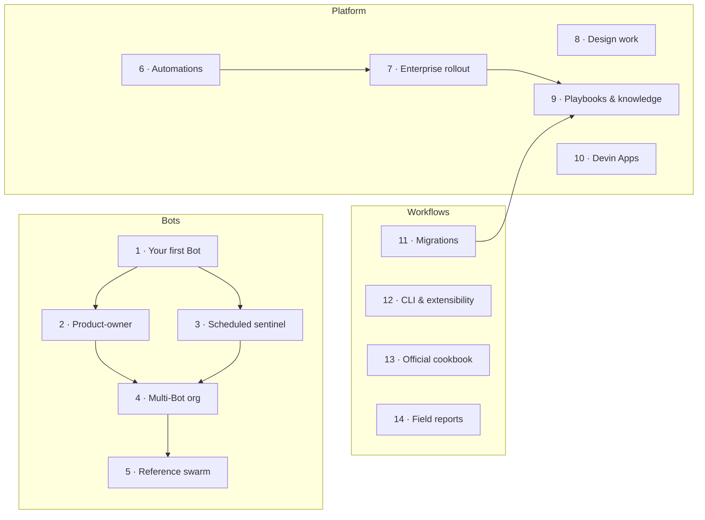

<picture>
  <source media="(prefers-color-scheme: dark)" srcset="assets/cover-dark.svg">
  
</picture>

 

Curated by [@darega0mae](https://x.com/darega0mae) · Sister registry: [built-with-devin](https://github.com/Till3005/built-with-devin) · [Improve a guide](CONTRIBUTING.md)

**14** guides · **3** tracks · every pattern reverse-engineered from a named, documented deployment

> *Unofficial community project — not affiliated with, endorsed by, or sponsored by Cognition AI. "Devin" is a trademark of Cognition AI. Brand assets are used under the official kit at [devin.ai/brand](https://devin.ai/brand). Official docs: [docs.devin.ai](https://docs.devin.ai).*

**Build with Devin** is a tutorial collection: every guide takes a *documented, real-world* Devin deployment — from Cognition's own launch fleet to published customer cases — and reverse-engineers it into steps you can reproduce on your own account. No hypothetical demos; every pattern here is backed by a named deployment with reported numbers.

**Pair it with [built-with-devin](https://github.com/Till3005/built-with-devin)** — the companion registry of everything the community and Cognition have shipped. Registry answers *what exists*; this repo answers *how to build it*.

## Guides

### Devin Bots

| # | Guide | You'll build | Based on | Level |
| --- | --- | --- | --- | --- |
| 1 | [Your first Bot](guides/bots-101-first-bot.md) | A Bot that owns an outcome — chat, sessions, Needs-you, memory, surfaces | [Official docs](https://docs.devin.ai/work-with-devin/bots) | Start here |
| 2 | [Product-owner Bot](guides/bots-201-product-owner.md) | A Bot that product-manages a whole app surface | Android Bot — 44 days, 1,134 PRs | Intermediate |
| 3 | [Scheduled-sentinel Bot](guides/bots-202-scheduled-sentinel.md) | A cron Bot that watches a check and fixes regressions | Layout Bot — 159 PRs/3wks | Intermediate |
| 4 | [Multi-Bot organization](guides/bots-203-multi-bot-org.md) | A Bot hierarchy with grants and roll-up reporting | SuperJennyStack — ~20 Bots, 1,900 PRs/wk | Advanced |
| 5 | [Reference-grounded swarm](guides/bots-204-reference-grounded-swarm.md) | A directed swarm writing a verified system | Harvey "Phil" — ~30 agents, 1M+ LOC | Advanced |

### Platform

| # | Guide | You'll build | Based on | Level |
| --- | --- | --- | --- | --- |
| 6 | [Event-driven automations](guides/automations-101-event-driven.md) | Sessions that fire on Slack, GitHub, Linear, cron, webhooks | [Automations docs](https://docs.devin.ai/product-guides/automations) | Start here |
| 7 | [Enterprise rollout patterns](guides/enterprise-playbook.md) | The six deployment shapes behind the biggest customer results | Nubank, Gumroad, EBANX, Modal, Airbyte… | Intermediate |
| 8 | [Design & visual work](guides/design-with-devin.md) | Art-directing production UI through Devin chat | Spraycash landing page write-up | Intermediate |
| 9 | [Playbooks & knowledge](guides/playbooks-and-knowledge.md) | Encoding org conventions so every session inherits them | The layer behind every enterprise result | Intermediate |
| 10 | [Devin Apps](guides/devin-apps.md) | Live internal tools and dashboards served from Devin's machine | [Devin Apps launch](https://devin.ai/blog/devin-apps) | Start here |

### Workflows

| # | Guide | You'll build | Based on | Level |
| --- | --- | --- | --- | --- |
| 11 | [Migrations at scale](guides/migrations-at-scale.md) | A migration as hundreds of small verified PRs | Official playbook + Nubank | Intermediate |
| 12 | [Devin CLI & extensibility](guides/devin-cli.md) | The local agent: cloud handoff, skills, plugins, hooks | [CLI docs](https://docs.devin.ai/cli/index.md) | Intermediate |
| 13 | [Official use-case cookbook](guides/official-cookbook.md) | 40+ documented recipes — hygiene loops, incidents, quality | [Use-case gallery](https://docs.devin.ai/use-cases/gallery/index.md) | Start here |
| 14 | [Community field reports](guides/community-field-reports.md) | What real teams learned — wins, failures, and named deployments with numbers | 15+ published hands-on accounts | Start here |

---

## How to use this repo

- **New to Bots?** Do guide 1, then pick 2 or 3 — they're the two most reproducible.
- **Want quick wins?** Guide 13's scheduled-hygiene recipes are the cheapest first deployment.
- **Running a team?** Guides 4, 7 and 9 are written for you.
- Every guide ends with **Sources** — the launch post, docs page, or write-up the pattern was distilled from — and **Verify it**, the check that tells you the reproduction worked.

---

## Conventions

- Each guide is self-contained: goal → prerequisites → the build, step by step → operating the result → pitfalls.
- Prompts are quoted verbatim where a source published them; otherwise they're reconstructed and marked as such.
- Numbers in a guide come from the cited deployment, not from our guesses.

## Contributing

Found a better recipe, or reproduced one and have numbers? See [CONTRIBUTING.md](CONTRIBUTING.md).

## License

[CC0-1.0](LICENSE) — dedicated to the public domain.
