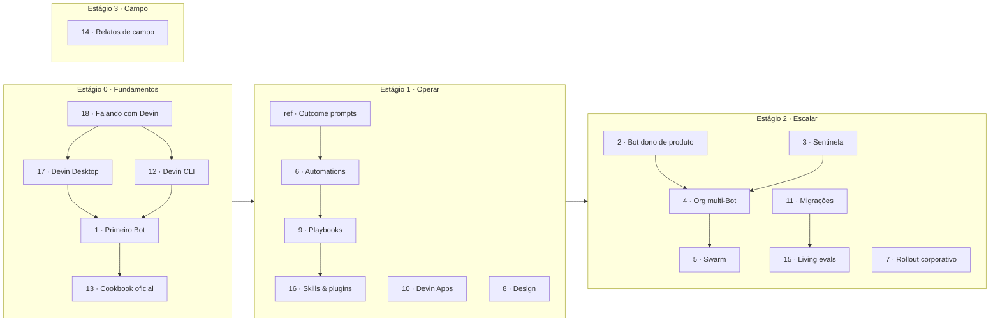

<picture>
  <source media="(prefers-color-scheme: dark)" srcset="assets/cover-dark.svg">
  
</picture>

 

Curado por [@darega0mae](https://x.com/darega0mae) · Registro irmão: [built-with-devin](https://github.com/Till3005/built-with-devin) · [Melhore um guia](CONTRIBUTING.md)

**19** guias · **4** estágios · todo padrão derivado de uma implantação nomeada e documentada

[English](README.md) · [简体中文](README.zh.md) · [日本語](README.ja.md) · Português

> *Projeto comunitário não oficial — sem afiliação, endosso ou patrocínio da Cognition AI. "Devin" é marca registrada da Cognition AI. Recursos de marca usados conforme o kit oficial em [devin.ai/brand](https://devin.ai/brand). Documentação oficial: [docs.devin.ai](https://docs.devin.ai).*

**Build with Devin** é uma coleção de tutoriais: cada guia pega uma implantação *real e documentada* do Devin — da frota de lançamento da própria Cognition a casos de clientes publicados — e a decompõe em passos reproduzíveis na sua própria conta. Sem demos hipotéticos; todo padrão aqui tem uma implantação nomeada e números publicados por trás.

**Use junto com [built-with-devin](https://github.com/Till3005/built-with-devin)** — o registro irmão de tudo que a comunidade e a Cognition já entregaram. O registro responde *o que existe*; este repo responde *como construir*.

## Guias

### Estágio 0 · Fundamentos

*Do zero a uma tarefa entregue. Todos começam aqui — as duas superfícies, a doutrina do prompt, a primeira posse, o livro de receitas.*

| # | Guia | Você vai construir | Baseado em | Nível |
| --- | --- | --- | --- | --- |
| 18 | [Falando com Devin: a doutrina do prompt](guides/pt/talking-to-devin.md) | Briefs que Devin não lê errado — say-how, sucesso verificável, regra dos 80% | [Coding Agents 101](https://devin.ai/agents101) + [docs oficiais de prompting](https://docs.devin.ai/essential-guidelines/instructing-devin-effectively) | Comece aqui |
| 17 | [Devin Desktop](guides/pt/devin-desktop.md) | O editor nativo de agentes: Command Center, sessões locais duráveis, Bots — uma janela | [Changelog do Desktop](https://docs.devin.ai/desktop/changelog) | Comece aqui |
| 12 | [Devin CLI & extensibilidade](guides/pt/devin-cli.md) | O agente local: sessões daemon, handoff para a nuvem, skills, hooks | [Docs do CLI](https://docs.devin.ai/cli/index.md) | Intermediário |
| 1 | [Seu primeiro Bot](guides/pt/bots-101-first-bot.md) | Um Bot dono de um resultado — chat, sessões, Needs-you, memória, superfícies | [Documentação oficial](https://docs.devin.ai/work-with-devin/bots) + post de lançamento | Comece aqui |
| 13 | [Cookbook oficial de casos de uso](guides/pt/official-cookbook.md) | 40+ receitas documentadas — loops de higiene, incidentes, qualidade | [Galeria de casos de uso](https://docs.devin.ai/use-cases/gallery/index.md) | Comece aqui |

### Estágio 1 · Operar

*O loop diário delegado: um Bot que conhece o padrão, sessões que disparam em eventos, convenções codificadas uma vez, ferramentas servidas ao vivo.*

| # | Guia | Você vai construir | Baseado em | Nível |
| --- | --- | --- | --- | --- |
| — | [Prompts de outcome de Bots, dissecados](guides/pt/bot-outcome-prompts.md) | Prompts de outcome que atribuem propriedade, não tarefas — os reais, por engenharia reversa | Prompt do Android Bot + os 16 templates do marketplace | Referência |
| 6 | [Automations orientadas a eventos](guides/pt/automations-101-event-driven.md) | Sessões disparadas por Slack, GitHub, Linear, cron, webhooks | [Docs de Automations](https://docs.devin.ai/product-guides/automations) | Comece aqui |
| 9 | [Playbooks & conhecimento](guides/pt/playbooks-and-knowledge.md) | Codificar as convenções da org para toda sessão herdá-las | A camada por trás de todo resultado corporativo | Intermediário |
| 16 | [Skills e plugins](guides/pt/skills-and-plugins.md) | A camada pós-playbook — contrato SKILL.md, descoberta, empacotamento em plugins | [Docs de Skills](https://docs.devin.ai/product-guides/skills) | Intermediário |
| 10 | [Devin Apps](guides/pt/devin-apps.md) | Ferramentas internas e dashboards ao vivo servidos da máquina do Devin | [Lançamento Devin Apps](https://devin.ai/blog/devin-apps) | Comece aqui |
| 8 | [Trabalho de design & visual](guides/pt/design-with-devin.md) | Direção de arte de UI de produção via chat do Devin | Relato da landing page Spraycash | Intermediário |

### Estágio 2 · Escalar

*De um Bot a uma organização: os quatro arquétipos de implantações nomeadas, depois a maquinaria pesada — migrações, evals, rollout corporativo.*

| # | Guia | Você vai construir | Baseado em | Nível |
| --- | --- | --- | --- | --- |
| 2 | [Bot dono de produto](guides/pt/bots-201-product-owner.md) | Um Bot que gerencia como produto uma superfície inteira de app | Android Bot — 44 dias, 1.134 PRs | Intermediário |
| 3 | [Bot sentinela agendado](guides/pt/bots-202-scheduled-sentinel.md) | Um Bot em cron que vigia uma checagem e corrige regressões | Layout Bot — 159 PRs/3 sem. | Intermediário |
| 4 | [Organização multi-Bot](guides/pt/bots-203-multi-bot-org.md) | Uma hierarquia de Bots com grants e relatórios consolidados | SuperJennyStack — ~20 Bots, 1.900 PRs/sem | Avançado |
| 5 | [Swarm ancorado em referência](guides/pt/bots-204-reference-grounded-swarm.md) | Um swarm dirigido escrevendo um sistema verificado | Harvey "Phil" — ~30 agentes, 1M+ linhas | Avançado |
| 11 | [Migrações em escala](guides/pt/migrations-at-scale.md) | Uma migração como centenas de PRs pequenos e verificados | Playbook oficial + Nubank | Intermediário |
| 15 | [Living evals de traces de produção](guides/pt/living-evals.md) | Uma suite de evals autocrescente: Devin reproduz falhas de produção numa cópia completa do sistema | Rox — 72% de cobertura de uso vs 43–57% escrito à mão | Avançado |
| 7 | [Padrões de rollout corporativo](guides/pt/enterprise-playbook.md) | As seis formas de implantação por trás dos maiores resultados | Nubank, Gumroad, EBANX, Modal, Airbyte… | Intermediário |

### Estágio 3 · Campo

*O que times de verdade aprenderam — vitórias, falhas e os números publicados.*

| # | Guia | Você vai construir | Baseado em | Nível |
| --- | --- | --- | --- | --- |
| 14 | [Relatos de campo da comunidade](guides/pt/community-field-reports.md) | O que times reais aprenderam — vitórias, falhas e implantações nomeadas com números | 15+ relatos hands-on publicados | Comece aqui |

<a href="#readme">back to top</a>

---

## Como usar este repositório

Na primeira leitura siga os estágios; depois, pule à vontade.

- **Dev solo, primeiro contato:** 18 → 17 (ou 12 se você vive no terminal) → 1 → 13. Um fim de semana.
- **Quer vitórias rápidas:** as receitas de higiene agendada do guia 13 são a implantação inicial mais barata.
- **Líder de time:** some 6, 9, 16 — o loop, as convenções, a camada de reuso.
- **Gerenciando uma org:** todo o Estágio 2, depois 7 — e leia 14 sobre o que outros times realmente enfrentaram.
- Todo guia termina com **Sources** — docs oficiais *e* o relato comunitário/de campo do qual o padrão foi destilado — e **Verify it**, a checagem que confirma que a reprodução funcionou.

<a href="#readme">back to top</a>

---

## Convenções

- Cada guia é autocontido: objetivo → pré-requisitos → a construção, passo a passo → operar o resultado → armadilhas.
- Prompts são citados literalmente quando a fonte os publicou; caso contrário são reconstruções, marcadas como tal.
- Os números de um guia vêm da implantação citada, não de suposições nossas.

## Contribuindo

Encontrou uma receita melhor, ou reproduziu uma e tem números? Veja [CONTRIBUTING.md](CONTRIBUTING.md).

## Licença

[CC0-1.0](LICENSE) — dedicado ao domínio público.
