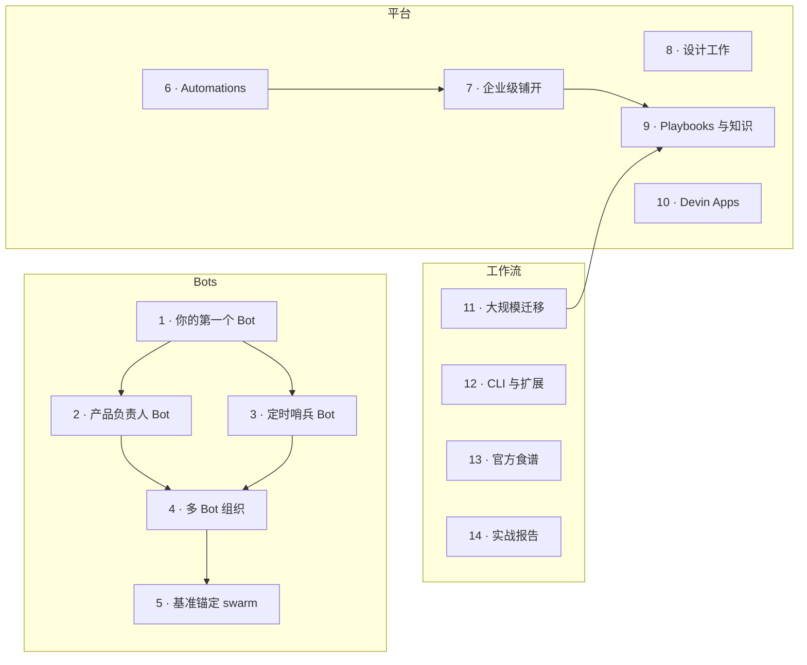

<picture>
  <source media="(prefers-color-scheme: dark)" srcset="assets/cover-dark.svg">
  
</picture>

 

维护者 [@darega0mae](https://x.com/darega0mae) · 姊妹登记库：[built-with-devin](https://github.com/Till3005/built-with-devin) · [改进指南](CONTRIBUTING.md)

**15** 篇指南 · **3** 条轨道 · 每个模式都逆向自实名、有据可查的部署

[English](README.md) · 简体中文 · [日本語](README.ja.md) · [Português](README.pt.md) · [Español](README.es.md) · [Deutsch](README.de.md)

> *非官方社区项目 —— 与 Cognition AI 无关联、未获其背书或赞助。"Devin" 是 Cognition AI 的商标。品牌素材依照 [devin.ai/brand](https://devin.ai/brand) 官方品牌包使用。官方文档：[docs.devin.ai](https://docs.devin.ai)。*

**Build with Devin** 是一套教程集：每篇指南拿一个*有据可查的真实* Devin 部署 —— 从 Cognition 自己的首发舰队到公开客户案例 —— 逆向成你可以在自己账号上复现的步骤。没有假想 demo；这里的每个模式都有实名部署和公开数字背书。

**搭配 [built-with-devin](https://github.com/Till3005/built-with-devin)** —— 收录社区与 Cognition 全部交付物的姊妹登记库。登记库回答*有什么*；本库回答*怎么造*。

## 指南

### Devin Bots

| # | 指南 | 你将做出 | 基于 | 难度 |
| --- | --- | --- | --- | --- |
| 1 | [你的第一个 Bot](guides/zh/bots-101-first-bot.md) | 一个对结果负责的 Bot —— chat、sessions、Needs-you、记忆、接入面 | [官方文档](https://docs.devin.ai/work-with-devin/bots) | 从这里开始 |
| 2 | [产品负责人 Bot](guides/zh/bots-201-product-owner.md) | 一个产品管理整个应用表面的 Bot | Android Bot —— 44 天，1,134 个 PR | 进阶 |
| 3 | [定时哨兵 Bot](guides/zh/bots-202-scheduled-sentinel.md) | 一个按 cron 盯检查项、自己修回归的 Bot | Layout Bot —— 3 周 159 个 PR | 进阶 |
| 4 | [多 Bot 组织](guides/zh/bots-203-multi-bot-org.md) | 带 grants 和汇总上报的 Bot 层级 | SuperJennyStack —— ~20 个 Bot，每周 1,900 PR | 高级 |
| 5 | [基准锚定 swarm](guides/zh/bots-204-reference-grounded-swarm.md) | 一个写出可验证系统的受指挥 swarm | Harvey "Phil" —— ~30 个 agent，100 万+ 行 | 高级 |
| — | [Bot outcome prompts 逐句拆解](guides/zh/bot-outcome-prompts.md) | 授予所有权而非派任务的 outcome prompt——真实案例反向拆解 | Android Bot 原话 prompt + 全部 16 个官方模板 | 参考 |

### 平台

| # | 指南 | 你将做出 | 基于 | 难度 |
| --- | --- | --- | --- | --- |
| 6 | [事件驱动 automations](guides/zh/automations-101-event-driven.md) | 由 Slack、GitHub、Linear、cron、webhook 触发的会话 | [Automations 文档](https://docs.devin.ai/product-guides/automations) | 从这里开始 |
| 7 | [企业级铺开模式](guides/zh/enterprise-playbook.md) | 最大客户结果背后的六种部署形态 | Nubank、Gumroad、EBANX、Modal、Airbyte…… | 进阶 |
| 8 | [设计与视觉工作](guides/zh/design-with-devin.md) | 通过 Devin 对话给生产 UI 做美术指导 | Spraycash 落地页实录 | 进阶 |
| 9 | [Playbooks 与知识](guides/zh/playbooks-and-knowledge.md) | 把团队规范编码下来，让每个 session 继承 | 每个企业级结果背后的那一层 | 进阶 |
| 10 | [Devin Apps](guides/zh/devin-apps.md) | 从 Devin 的机器上提供的 live 内部工具和看板 | [Devin Apps 发布](https://devin.ai/blog/devin-apps) | 从这里开始 |

### 工作流

| # | 指南 | 你将做出 | 基于 | 难度 |
| --- | --- | --- | --- | --- |
| 11 | [大规模迁移](guides/zh/migrations-at-scale.md) | 拆成数百个可验证小 PR 的迁移 | 官方 playbook + Nubank | 进阶 |
| 12 | [Devin CLI 与扩展性](guides/zh/devin-cli.md) | 本地 agent：云端交接、skills、plugins、hooks | [CLI 文档](https://docs.devin.ai/cli/index.md) | 进阶 |
| 13 | [官方用例食谱](guides/zh/official-cookbook.md) | 40+ 个有据可查的配方 —— 卫生循环、事故响应、质量 | [用例 gallery](https://docs.devin.ai/use-cases/gallery/index.md) | 从这里开始 |
| 14 | [社区实战报告](guides/zh/community-field-reports.md) | 真实团队的经验 —— 赢的、败的、带数字的实名部署 | 15+ 篇已发布实操记述 | 从这里开始 |

---

## 如何使用本库

- **刚接触 Bots？** 做指南 1，然后挑 2 或 3 —— 这两个最好复现。
- **想要快速见效？** 指南 13 的定时卫生配方是最便宜的第一个部署。
- **带团队？** 指南 4、7、9 是为你写的。
- 每篇指南以 **Sources** 收尾 —— 模式蒸馏自哪篇发布帖/文档/记述 —— 以及 **Verify it**，告诉你复现是否成功的检查项。

---

## 约定

- 每篇指南自足：目标 → 前置条件 → 逐步搭建 → 运营结果 → 坑。
- 出处公开过的 prompt 逐字引用；其余为重写并注明。
- 指南里的数字来自所引用的部署，不是我们的估计。

## 贡献

找到错误，或有更好的复现路径？见 [CONTRIBUTING.md](CONTRIBUTING.md)。

## 许可证

[CC0-1.0](LICENSE) —— 贡献给公共领域。
